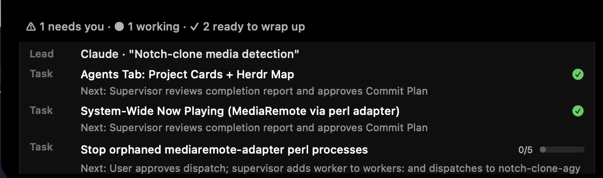

# NotchClone

A macOS background app that turns the MacBook camera notch into a small hover panel: now playing, a files tray, timers, notes, app launcher, system stats, and a live board of your AI coding agents.

Written from scratch in Swift using Apple frameworks only. No Dock icon, no account, no privacy permissions.



## Features

| Tab | What it does |
|---|---|
| **Home** | Now playing from any app (Chrome, Safari, YouTube, Spotify, Apple Music, VLC, podcasts) with play/pause/next/previous. Files tray: drop files on the notch, drag them out, or AirDrop them. |
| **Agents** | One card per project: the lead agent (Claude) and its status, the active task with progress and `Next:` step, and worker counts. A collapsible map of herdr workspaces and tabs. |
| **Timer** | Countdown with presets, stopwatch, Pomodoro (25/5, long break every 4). Plays the system "Glass" sound when done. |
| **Notes** | Auto-saving scratchpad stored at `~/Library/Application Support/NotchClone/notes.txt`. |
| **Launch** | Pinned apps (drag an `.app` onto the notch to pin) and your macOS Shortcuts. |
| **System** | CPU graph, memory, network rates, and weather by city name (Open-Meteo, no location permission). |

Also:

- **Closed notch indicators:** mini album art while music plays, running timer, and an orange badge with the count of agents waiting for you.
- **Menu bar item:** shows the waiting-agent count. Its popover has an agent status ring, a 7-day token usage chart, today's usage by tool, the 5-hour Claude usage window, and the same project cards.

## Requirements

- macOS 14 or later, on a MacBook with a camera notch
- Apple Silicon
- Swift 6 toolchain (Xcode or the command line tools) to build
- Optional, for the Agents tab: herdr running, and a plans folder (see below)
- Optional, for the usage popover: `bun` and `ccusage`

## Build and run

```bash
./scripts/bundle.sh          # builds release binary and assembles build/NotchClone.app
open build/NotchClone.app
```

To quit: right-click the notch and choose **Quit NotchClone**, or `pkill -x NotchClone`.

## How the Agents tab works

The tab combines two sources. Nothing is written back to either.

**1. Live agents from herdr.** The app runs `herdr api snapshot` (every 5 s while the tab or popover is open, every 15 s otherwise) and reads workspaces, tabs, agents and their status (`working`, `idle`, `done`, `blocked`).

**2. Plan files.** The app scans `<vault>/<project>/plan/*.md`. A plan is a markdown file with this frontmatter:

```markdown
---
status: IN PROGRESS          # PLANNING | IN PROGRESS | BLOCKED | COMPLETED
next: "What should happen next"
workers: [my-worker-agent]   # herdr agent names working on this plan
---

# My Feature [IN PROGRESS]

- [x] Done step
- [ ] Open step
```

- The title is the first `# ` heading, without the `[STATUS]` suffix.
- Progress is the count of `- [x]` against `- [ ]` lines.
- `COMPLETED` plans, and plans untouched for 14 days with no live worker, are hidden.
- `plan/archive/` is ignored.

**Grouping.** A plan is placed under a herdr workspace by, in order: a live agent named in `workers:`; a workspace whose label equals the project folder name; an agent whose working directory ends in the project folder name. Anything unmatched goes under **No active session**.

**Lead.** The `claude` agent in that workspace. herdr does not expose Claude's internal progress, so the lead row shows its session title and status, and progress comes from the plan checklist.

Click a lead row, task row or map row to focus that agent's terminal.

## How Now Playing works

macOS 15.4 and later reject calls to the private MediaRemote framework from apps without an Apple entitlement. NotchClone runs the open-source [`mediaremote-adapter`](https://github.com/ungive/mediaremote-adapter) through `/usr/bin/perl` (a system binary that is allowed) and reads its JSON stream, so updates arrive as pushes with no polling.

- Browser tabs appear only if the page publishes Media Session metadata (YouTube, Spotify Web, SoundCloud do).
- If the adapter is missing or exits, the app falls back to AppleScript for Spotify and Apple Music.
- This is a private-API workaround and can break on a macOS update.
- The adapter child is stopped on quit and on SIGTERM/SIGINT, and leftover children from a crash are cleaned up on the next launch.

## Permissions and privacy

- No Location, Accessibility, Screen Recording, Notifications or Calendar permissions.
- macOS may ask once for **Automation** permission so the app can read and control Spotify / Music via AppleScript.
- Weather sends only the city name you type to Open-Meteo. Nothing else leaves the machine.
- Token usage is read with `ccusage --offline`.

## Configuration

Set with `defaults write com.noxturne.notchclone <key> <value>`:

| Key | Default | Purpose |
|---|---|---|
| `vaultProjectsPath` | `~/Projects/my-notes/projects` | Folder scanned for `<project>/plan/*.md` |
| `terminalBundleId` | `com.mitchellh.ghostty` | Terminal app brought to the front when you click an agent |

```bash
defaults write com.noxturne.notchclone terminalBundleId "com.apple.Terminal"
```

## Project layout

```
Sources/NotchClone/     app source (one type per file)
Resources/              Info.plist, bundled mediaremote-adapter
scripts/bundle.sh       build + bundle + ad-hoc code sign
docs/screenshots/       README images
```

## Notes

- Costs in the usage popover are `ccusage` estimates at public pay-per-token API prices, a measure of workload size and not subscription billing.
- On menu bars with many items, macOS may hide overflow items behind the notch.
- The bundle is ad-hoc signed, so macOS may re-ask for Automation permission after a rebuild.

## Credits

- [`mediaremote-adapter`](https://github.com/ungive/mediaremote-adapter) by Jonas van den Berg and contributors (BSD-3-Clause), bundled under `Resources/mediaremote-adapter/` with its license.
- Weather data from [Open-Meteo](https://open-meteo.com).
